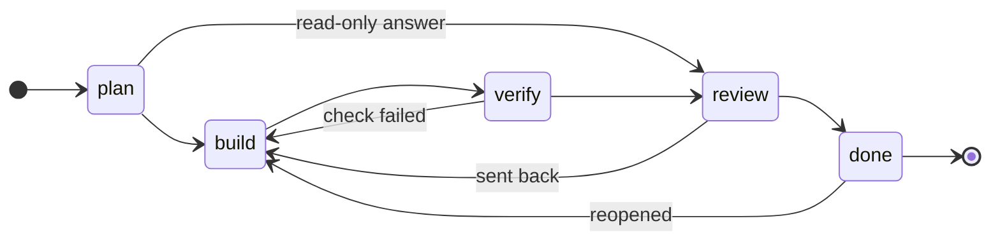

# Task state

One task, one folder, whichever agent holds it. The folder is the handoff: an agent that never saw the conversation resumes from it.

```
<repo>/.agents/state/<id>/
  STATE.md       goal, plan, tasks, handoff, walkthrough, and the lifecycle chart
  DECISIONS.tsv  one row per decision: ts, phase, decision, why, evidence, result
  agents/<role>/ BRIEFING.md, progress.md, handoff.md for each helper agent
```

Change it with the script, not by hand, so the gates run and the chart stays current: `python <this skill>/scripts/state.py <command>` (`python3` on Linux). Hand edits are tolerated; run `state.py check` after one.

In Antigravity, read `../../docs/harness/antigravity.md` once per session. In Claude Code, read `../../docs/harness/claude-code.md`.

## When

- A task with more than a couple of steps, a file at the end, or more than one session: open it before the first edit.
- Before handing work to the other agent or to the owner.
- When pausing (context filling up, owner away, a blocker).
- When you start work someone else began: `state.py status`, then `resume`.

A one-line fix or a question answered in the reply needs no state.

## The lifecycle



Any active phase can go to `paused` or `blocked` and comes back to the phase it left. The script refuses a move the chart does not draw, and these gates hold:

| Move | Needs |
| --- | --- |
| leave `plan` | a Plan section and at least one task |
| to `review` or `done` | every task done or skipped with a reason, and a Walkthrough with the evidence |
| to `done` | `--by` someone other than the builder (the owner of the last `build`) |
| to `paused` or `blocked` | `--next "<first action on resume>"` |
| `handoff --for review` | the task is in `review` (so the tasks are closed and the Walkthrough holds the evidence) |

The builder never closes its own work. Claude reviews Antigravity's and Antigravity's teamwork auditor or the owner reviews Claude's.

## The order of work

The state follows the work as it happens, not afterwards. A state opened after the fix, still in `plan`, says the work was never built.

1. `init`, then `plan` and `task add` with the matched playbook's steps, **before the first edit**.
2. `phase build` before you edit. Tick tasks as each one is done.
3. `phase verify` when the change is in; run the gate; `walkthrough` with the commands and their output.
4. `phase review`, then hand the review to someone else: `handoff --for review`.

## Commands

```sh
state.py init <id> --title "..." --goal "<the owner's goal in their words>" [--owner claude|antigravity|human] [--branch b]
state.py plan <id> --file plan.md          # or --text "..."
state.py task <id> add "write the failing test" "fix" "run the gate"
state.py task <id> done 1 | skip 3 --reason "LINUX_CI off" | undo 2
state.py phase <id> build --reason "plan agreed"
state.py log <id> --decision "..." --why "..." --evidence "<sha, run id, file:line>" --result "..."
state.py walkthrough <id> --file walkthrough.md
state.py phase <id> review --reason "gate green" --evidence "run 1234"
state.py handoff <id> --to antigravity --for build|review|plan|decide --next "..." [--files "..."] [--questions "..."]
state.py phase <id> done --reason "audited" --by claude
state.py phase <id> paused --reason "context full" --next "rerun cargo test --test x"
state.py status [--owner antigravity] [--brief]      # every open task
state.py resume <id> --run <your session or conversation id> [--owner claude]
state.py agent <id> <role> --text "<the helper's part>"
state.py check                                         # exit 1 on problems
```

## The plan

Write the Plan in Antigravity's shape, so the owner reviews the same artifact in either agent:

```markdown
### Goal
### User Review Required      (decisions only the owner can make; omit when none)
### Open Questions
### Proposed Changes
#### [MODIFY] path/to/file     what changes and why
#### [NEW] path/to/test        the test that fails before the change
### Verification Plan          commands and the output that means done
```

Use `###` and deeper inside the Plan. The script splits the file at its own `##` sections and keeps any other heading inside the section it sits in.

## Tasks

Copy the matched playbook's steps in as tasks, verbatim, then the task-specific ones. A step you choose not to do is skipped with a reason, never deleted. Keep the agent's own to-do list (`TaskCreate`, the Antigravity task artifact) in step with it; the state file is what the other agent reads.

## The decision log

`DECISIONS.tsv` is pstack's show-me-your-work log; read `<pstack>/skills/show-me-your-work/SKILL.md` for what earns a row. The script writes a row for each phase move, skip and handoff. Add a row for each fork chosen, revert, blocker, and measured number (with the command that produced it). Append only: a wrong row gets a new row that supersedes it. `resume` writes the `start` row that names the rows other runs wrote.

## Drawing state

The Mermaid chart at the bottom of STATE.md is redrawn on every write: the current phase is filled, visited phases are shaded, and the owner is noted. For a system with its own states (a protocol, a cache, a UI flow), draw that too:

- a Mermaid `stateDiagram-v2` or `flowchart` in the Plan or Walkthrough, in the reader's words; or
- pstack's **statechart** skill, which also checks the rules with TLC. TLC is a model checker: skip it where the project parks formal verification, and draw by hand instead.

## Helpers

For a fan-out (pstack's swarm or arena, Antigravity teamwork), brief each helper with `state.py agent <id> <role> --text ...`. It writes `agents/<role>/BRIEFING.md` and `progress.md`; the helper writes `handoff.md` with what changed, commands run with their output, and what is left. You own the helpers' work: read the diff and their handoff, then log your own verdict.

## Git

`.agents/state/` is a working area. Leave it out of git unless a reviewer needs the trail to trust the result (a long autonomous run, an audit); then commit the task folder with the work.
